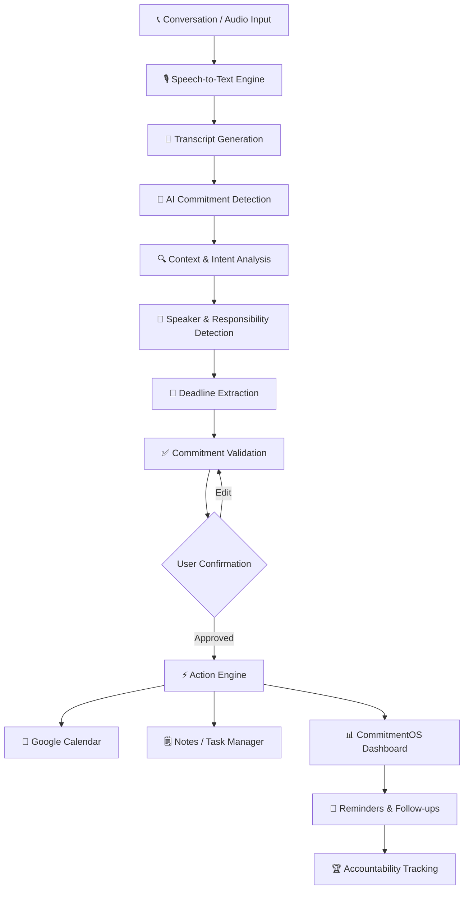
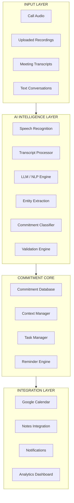

# Commitment-OS-V2
### Your Conversations. Your Commitments. Your Accountability.

<p align="center">
  
  
  
</p>

<p align="center">
  <b>Never Let a Promise Get Lost in a Conversation.</b>
</p>

<p align="center">
  An AI-powered commitment intelligence platform that transforms conversations into structured, trackable, and actionable commitments using speech intelligence, contextual AI, and productivity automation.
</p>

<p align="center">
  <a href="#-the-vision">Vision</a> •
  <a href="#-core-intelligence">Core Intelligence</a> •
  <a href="#-features">Features</a> •
  <a href="#-system-architecture">Architecture</a> •
  <a href="#-technology-stack">Tech Stack</a> •
  <a href="#-roadmap">Roadmap</a>
</p>

---

## 🟢 THE PROBLEM

We make promises every day.

- "I'll send you the document by tomorrow."
- "Let's connect next Friday."
- "I'll complete the project before the deadline."
- "I'll get back to you after discussing it with the team."

But what happens after the conversation ends?

Promises get forgotten. Deadlines get missed. Responsibilities become unclear. Important decisions disappear inside hundreds of messages and hours of conversations.

**Traditional productivity applications depend on users manually remembering and entering their commitments.**

What if your productivity system could understand what you promised without requiring you to manually create every task?

## ⚡ THE VISION

**CommitmentOS is an AI-powered operating system for personal and professional accountability.**

It transforms conversations into actionable commitments by identifying:

- WHAT was promised?
- WHO made the commitment?
- TO WHOM was it made?
- WHEN should it be completed?
- WHY is it important?
- WHAT happens next?

Instead of merely storing conversations, CommitmentOS extracts their intent and converts it into structured actions.

> From spoken promises to measurable accountability.

---

## 🧠 CORE INTELLIGENCE

### From Conversation → Commitment → Action



### The Intelligence Pipeline

| Stage | Intelligence | Output |
|---|---|---|
| 01 | Speech Recognition | Conversation transcript |
| 02 | Intent Detection | Commitment identification |
| 03 | Context Understanding | Meaning and intent |
| 04 | Entity Extraction | Person, task, deadline |
| 05 | Classification | Promise, intention, suggestion |
| 06 | Validation | Confidence and evidence |
| 07 | Action Generation | Calendar events and tasks |
| 08 | Accountability | Reminders and progress |

---

## 🚀 FEATURES

### 01. AI-Powered Commitment Extraction

- Intelligent commitment identification.
- Natural language deadline detection.
- Multi-commitment extraction.
- Speaker responsibility identification.
- Context-aware intent classification.
- Conditional commitment recognition.
- Multilingual and Hinglish understanding.
- Commitment confidence scoring.
- Evidence-based extraction.
- Ambiguity detection.

### 02. Smart Conversation Intelligence

- Speech-to-text transcription.
- Speaker diarization where supported.
- Timestamp-based transcript navigation.
- Highlighted commitment evidence.
- AI-powered conversation summaries.
- Searchable conversation history.
- Contradiction detection.
- Missed commitment recovery.
- Transcript-to-task conversion.
- Audio evidence playback.

### 03. Intelligent Productivity Automation

- Google Calendar synchronization.
- Notes and task integration.
- Automatic reminder generation.
- Duplicate commitment detection.
- Smart deadline suggestions.
- Recurring commitment identification.
- Calendar conflict detection.
- Intelligent rescheduling suggestions.
- Follow-up message generation.
- Cross-device synchronization.

### 04. Accountability Intelligence

- Commitment completion tracking.
- Personal reliability analytics.
- Overdue commitment recovery.
- Weekly accountability reports.
- Commitment streaks.
- Promise-to-action conversion rate.
- Workload forecasting.
- Deadline risk prediction.
- Commitment dependency mapping.
- Personal AI accountability assistant.

### 05. Advanced AI Capabilities

- Agentic commitment management.
- Explainable AI decisions.
- Commitment knowledge graph.
- Cross-conversation memory.
- What-if deadline simulation.
- AI-powered ambiguity resolution.
- Proactive deadline notifications.
- Multi-agent verification.
- Commitment digital twin.
- Natural language dashboard control.

### 06. Privacy & Security

- Explicit recording consent.
- Secure authentication.
- Protected transcript storage.
- Sensitive information redaction.
- Granular access permissions.
- Configurable data retention.
- Deletion workflows.
- Audit logs.
- Secure integration authorization.
- Privacy-first architecture.

---

## 🟢 THE COMMITMENT INTELLIGENCE ENGINE

The most important part of CommitmentOS is its ability to understand the difference between ordinary conversation and an actual commitment.

**Example conversation:**

> "I'll send the project report to Rahul by Friday evening, and I'll schedule a review meeting next Monday."

**AI-Extracted Output:**

| Attribute | Extracted Information |
|---|---|
| Commitment 1 | Send project report |
| Responsible Person | Speaker |
| Recipient | Rahul |
| Deadline | Friday evening |
| Commitment 2 | Schedule review meeting |
| Responsible Person | Speaker |
| Deadline | Next Monday |

### Structured AI Output

```json
{
  "conversation_id": "CONV_001",
  "commitments": [
    {
      "action": "Send project report",
      "owner": "Speaker",
      "recipient": "Rahul",
      "deadline": "Friday evening",
      "type": "definite_promise",
      "priority": "high",
      "confidence": 0.96,
      "evidence": "I'll send the project report to Rahul by Friday evening.",
      "status": "pending_confirmation"
    },
    {
      "action": "Schedule review meeting",
      "owner": "Speaker",
      "deadline": "Next Monday",
      "type": "definite_promise",
      "priority": "medium",
      "confidence": 0.93,
      "evidence": "I'll schedule a review meeting next Monday.",
      "status": "pending_confirmation"
    }
  ]
}
```

*Illustrative output schema. Confidence values are examples, not measured model performance.*

---

## 🏗️ SYSTEM ARCHITECTURE



### Architectural Principles

- Modular and scalable architecture.
- Separation of transcription and reasoning.
- Structured AI outputs.
- Human-in-the-loop verification.
- Secure API integrations.
- Asynchronous background processing.
- Reliable task and event synchronization.

---

## 🛠️ TECHNOLOGY STACK

| Layer | Technologies |
|---|---|
| Frontend | React.js / Next.js |
| Language | TypeScript, JavaScript |
| Styling | Tailwind CSS |
| UI Animation | Framer Motion |
| Typography | Architects Daughter |
| Backend | Python, FastAPI |
| AI / NLP | LLMs, NLP, Structured Outputs |
| Speech Processing | Speech-to-Text APIs |
| Database | PostgreSQL |
| Authentication | Google OAuth |
| Calendar | Google Calendar API |
| Notifications | Firebase Cloud Messaging |
| Deployment | Vercel / Cloud Hosting |
| Version Control | Git & GitHub |

*The stack represents the intended architecture; individual integrations are subject to implementation.*

---

## 🎨 EXPERIENCE & DESIGN PHILOSOPHY

CommitmentOS is designed to make productivity feel intelligent, minimal, and interactive.

### NVIDIA-Inspired Visual Identity

| Design Element | Specification |
|---|---|
| Primary Accent | NVIDIA Green `#76B900` |
| Background | Deep Black `#0B0B0B` |
| Secondary Background | `#151515` |
| Text | `#F5F5F5` |
| Accent Glow | Subtle Green |
| Font | Architects Daughter |
| UI Style | Modern, Minimal, Futuristic |
| Theme | Light & Dark |

### Interface Highlights

- Interactive AI dashboard.
- Responsive sidebar navigation.
- Live commitment status cards.
- Animated activity indicators.
- Dynamic commitment timelines.
- Drag-and-drop task organization.
- Interactive analytics.
- Smooth light/dark theme transitions.
- Mobile-first responsive layouts.
- Accessible interaction patterns.

---

## 📊 THE COMMITMENT DASHBOARD

The dashboard is designed around four essential questions:

1. What have I promised?
2. What do I need to complete today?
3. What am I waiting for?
4. What commitments are at risk?

### Dashboard Modules

| Module | Purpose |
|---|---|
| Today's Commitments | Daily action overview |
| Upcoming Deadlines | Future responsibilities |
| Recent Conversations | Latest processed transcripts |
| AI Insights | Contextual recommendations |
| Pending Confirmation | Unverified extracted commitments |
| Overdue Tasks | Missed deadlines |
| Accountability Analytics | Progress and completion trends |

---

## 🧬 WHAT MAKES COMMITMENTOS DIFFERENT?

| Traditional Productivity Apps | CommitmentOS |
|---|---|
| Manual task creation | AI-assisted extraction |
| User remembers deadlines | Natural language deadline detection |
| Static reminders | Context-aware reminders |
| Isolated task records | Conversation-linked commitments |
| Manual accountability | Automated progress tracking |
| Basic task organization | Commitment intelligence |
| Limited conversational context | Context-aware reasoning |

**Our differentiation:** CommitmentOS focuses on the missing layer between human communication and task execution.

It does not simply manage tasks. It understands the promises that create those tasks.

---

## 🗺️ DEVELOPMENT ROADMAP

- [x] Project vision and product concept
- [x] Feature identification and architecture planning
- [ ] Responsive frontend development
- [ ] NVIDIA-inspired UI implementation
- [ ] Authentication and user management
- [ ] Audio upload and transcript processing
- [ ] AI commitment extraction
- [ ] Commitment review and confirmation
- [ ] Google Calendar integration
- [ ] Notes and task integration
- [ ] Reminder and notification engine
- [ ] Accountability analytics
- [ ] Advanced AI agent
- [ ] Security and privacy testing
- [ ] Production deployment

---

## 🔮 FUTURE VISION

CommitmentOS aims to evolve into a personal accountability intelligence layer that connects conversations, meetings, emails, tasks, and calendars.

### Beyond Task Management

**Commitment Digital Twin**

A continuously updated representation of your promises, responsibilities, dependencies, and deadlines.

**Promise Recovery Agent**

An intelligent assistant that detects overdue commitments and suggests recovery actions.

**Cross-Conversation Memory**

Connect commitments across multiple authorized conversations without losing their original context.

**Personal Accountability Copilot**

Ask questions such as:

- What did I promise Rahul last week?
- Which commitments are due tomorrow?
- Which promises are still waiting for confirmation?
- What am I likely to miss this week?
- Which tasks depend on someone else's response?

---

## 🔐 PRIVACY FIRST. ALWAYS.

Conversations can contain sensitive personal and professional information.

CommitmentOS is designed around:

- Explicit consent for audio recording and processing.
- Secure authentication and authorization.
- Minimum necessary integration permissions.
- Protected storage and controlled access.
- User-controlled retention and deletion.
- Transparent AI-generated results.
- Human confirmation before external actions.

Privacy is not an optional feature. It is a foundational design principle.

---

## 💡 THE BIG IDEA

> A conversation lasts minutes. A commitment can last days, weeks, or months. Your productivity system should never forget the difference.

CommitmentOS transforms spoken intentions into organized responsibilities and measurable actions.

**Because remembering a promise is important. Keeping it is everything.**

---

## 🤝 CONTRIBUTION & COLLABORATION

Ideas, improvements, and contributions are welcome.

1. Fork the repository.
2. Create a feature branch.
3. Implement your improvement.
4. Test your changes.
5. Submit a pull request.

---

## 👨‍💻 PROJECT INFORMATION

**Project:** CommitmentOS  
**Category:** Artificial Intelligence | NLP | Productivity Automation | Agentic AI  
**Development Focus:** AI-powered Commitment Intelligence  
**Status:** Active Development

---

<p align="center">
  
</p>

<h3 align="center">COMMITMENTOS</h3>

<p align="center">
  <b>Don't Just Remember Conversations. Remember What You Promised.</b>
</p>

<p align="center">
  🟢 THINK SMARTER. COMMIT BETTER. DELIVER MORE.
</p>

<p align="center">
  <sub>Built with innovation, intelligence, and accountability.Built with Nemotron-4 340B, Nemotron-Mini and NVIDIA Technologies</sub>
</p>
